<a href="https://lakshay-portfolio-c98s.onrender.com/">
  
</a>

  
  
  
  
  






<a href="https://lakshay-portfolio-c98s.onrender.com/work/avecagro"></a>

  
  
  

<a href="https://lakshay-portfolio-c98s.onrender.com/work/trustprint"></a>

  

<a href="https://lakshay-portfolio-c98s.onrender.com/work/airline-retention"></a>

  
  

<a href="https://lakshay-portfolio-c98s.onrender.com/work/stocksense"></a>

  
  
  

<a href="https://lakshay-portfolio-c98s.onrender.com/work/ipl-auction"></a>

  






<picture>
  <source media="(prefers-color-scheme: dark)" srcset="https://raw.githubusercontent.com/LakshayBansal06/LakshayBansal06/output/snake-dark.svg">
  <source media="(prefers-color-scheme: light)" srcset="https://raw.githubusercontent.com/LakshayBansal06/LakshayBansal06/output/snake-light.svg">
  
</picture>

  
  

  




  
  
  
  

<a href="https://lakshay-portfolio-c98s.onrender.com/">
  
</a>
